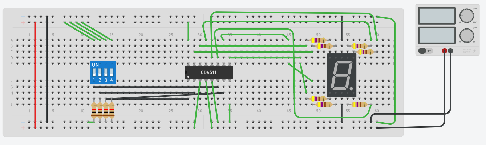
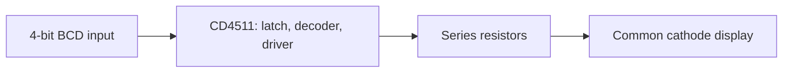

# BCD to 7-Segment Display with CD4511

A 4-bit BCD input shown as a digit from 0 to 9 on a common cathode 7-segment display, using a CD4511 decoder. Simulated in Proteus, with a breadboard layout.

## How it works

The CD4511 decodes the BCD code and drives the matching segments. The digit is set by hand with the inputs; there is no automatic counting circuit in this project.

## Components

| Part | Quantity |
|---|---|
| CD4511 | 1 per digit |
| Common cathode 7-segment display | 1 per digit |
| 330 ohm segment resistors | 7 per digit |
| DIP switch or logic inputs | 4 per digit |
| 5 V supply | 1 |

The breadboard picture uses 470 ohm segment resistors and 1 k ohm pull-downs on the inputs. Either segment value works; 470 ohm is slightly dimmer.

## CD4511 pins

| Pin | Name | Connect to |
|---|---|---|
| 7, 1, 2, 6 | A, B, C, D | BCD input, A is the least significant bit |
| 3 | LT | +5 V |
| 4 | BI | +5 V |
| 5 | LE | Ground |
| 8 | VSS | Ground |
| 16 | VDD | +5 V |
| 13, 12, 11, 10, 9, 15, 14 | a, b, c, d, e, f, g | Segments, through resistors |

## Truth table

| Digit | D C B A | Digit | D C B A |
|---|---|---|---|
| 0 | 0 0 0 0 | 5 | 0 1 0 1 |
| 1 | 0 0 0 1 | 6 | 0 1 1 0 |
| 2 | 0 0 1 0 | 7 | 0 1 1 1 |
| 3 | 0 0 1 1 | 8 | 1 0 0 0 |
| 4 | 0 1 0 0 | 9 | 1 0 0 1 |

To show **543**, use three CD4511 and display pairs with inputs `0101`, `0100` and `0011`.

## Run the simulation

1. Open [simulation/7_segment_display.pdsprj](simulation/7_segment_display.pdsprj) in Proteus.
2. Start the simulation.
3. Change the inputs and compare the digit with the table.

## Related

The same circuit as a short build guide: [seven-segment-4511](https://github.com/SMRUTIRANJAN30/seven-segment-4511).

## Author

**Smrutiranjan Sahoo**, Electronics and Communication Engineering
[GitHub](https://github.com/SMRUTIRANJAN30) · [Email](mailto:smrutiranjansahoopikun@gmail.com)

## License

[MIT](LICENSE)
